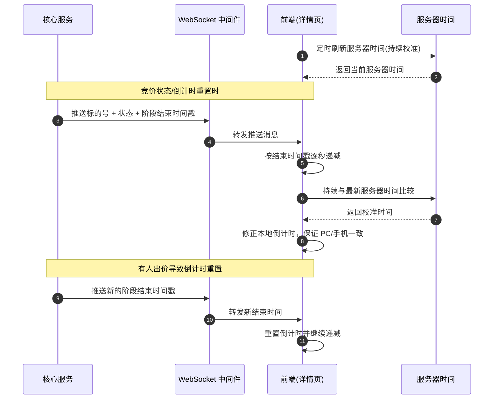
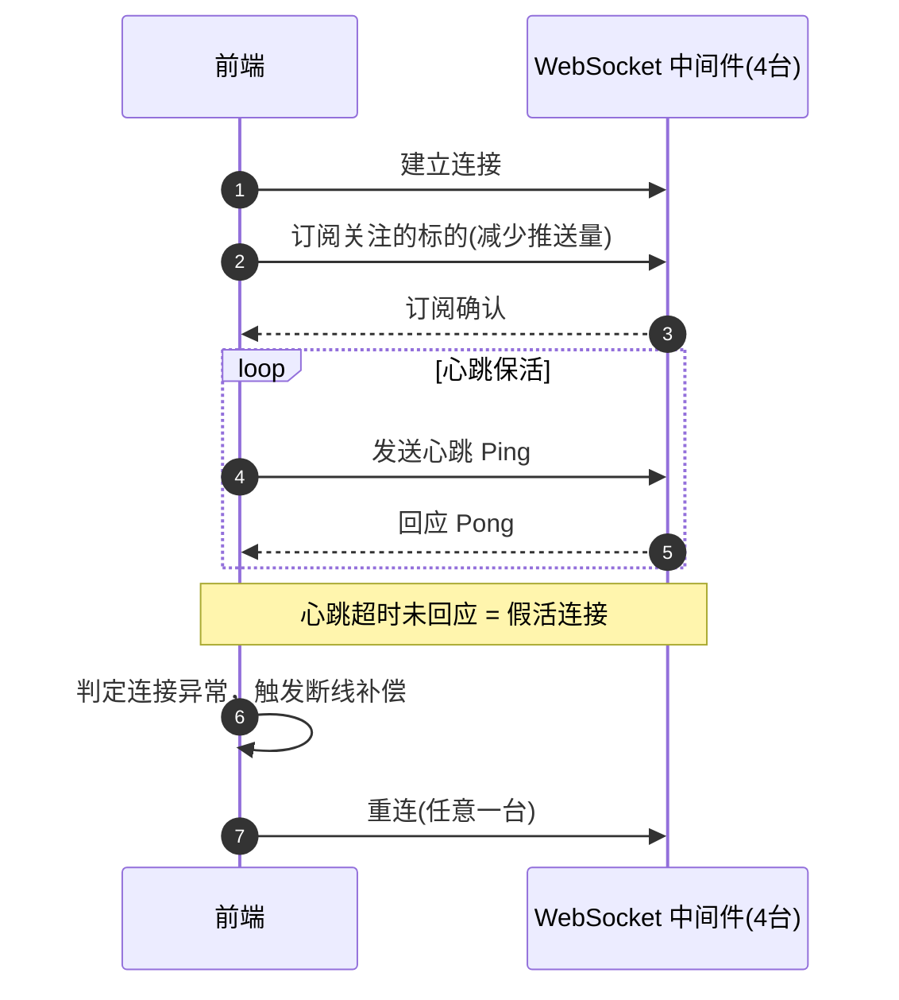
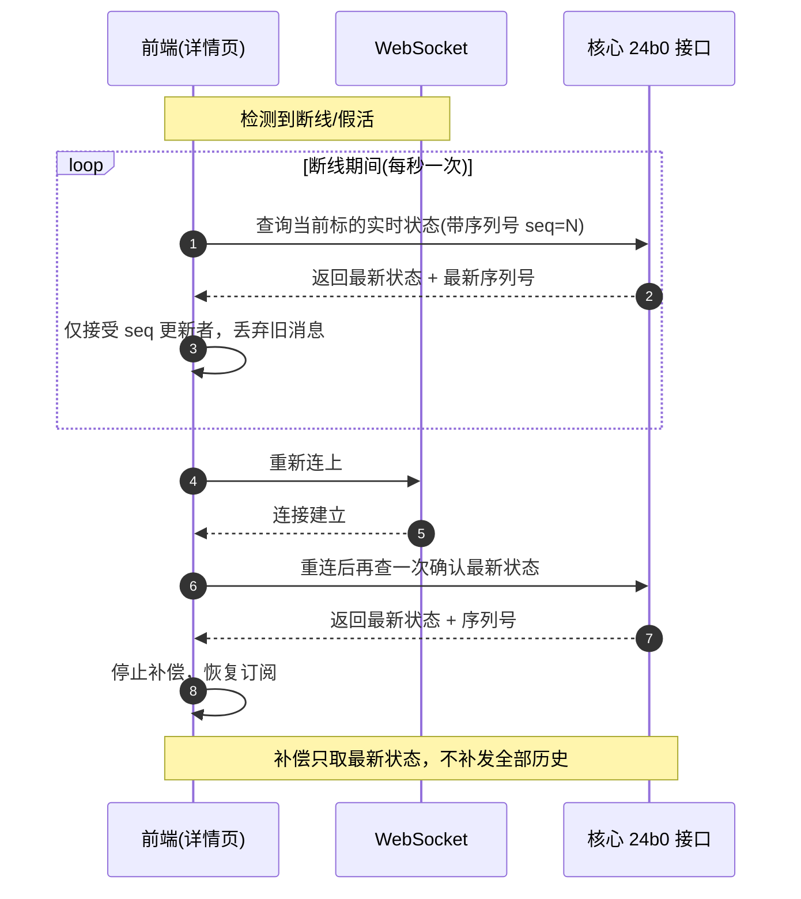
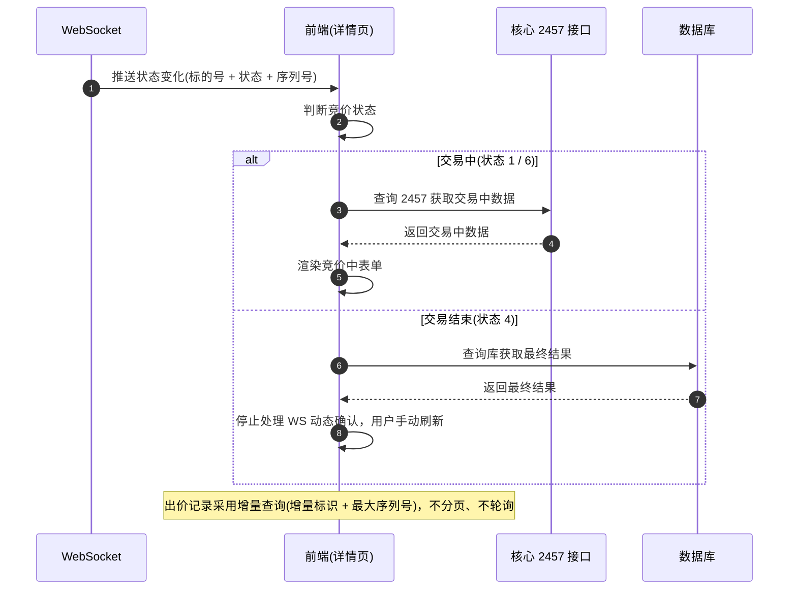

# 竞价状态不一致问题 —— 解决方案

> 来源：竞价系统改造方案技术讨论（2026-10-28）
> 范围：大厅/详情页竞价状态、倒计时、WebSocket 推送、缓存查询
> 总体路线：**核心推送状态、前端计算倒计时**
> 关联：推送通道、断线重连与兜底的实现方案见 [`midservice/竞价详情页轮询改造-WebSocket事件驱动方案.md`](./midservice/竞价详情页轮询改造-WebSocket事件驱动方案.md)——本文只讲**状态口径与补偿规则**，不复述通道设计。

---

## 一、问题定位：状态不一致的根因

| 编号 | 根因 | 现象 |
|------|------|------|
| 1 | 页面打开时的时序竞争 | 推送消息早于连接建立，或库状态异步未更新，首屏状态落后 |
| 2 | 倒计时口径不一 | 手机端/PC端不一致；凌控只在进页面取一次服务器时间，放久偏差几分钟 |
| 3 | WebSocket 不稳定 | 「链接还在但消息收不到」，静默丢消息 |
| 4 | 断线后无补偿 | 断线期间状态变化丢失，重连后不补 |
| 5 | 消息乱序 | 旧消息晚到覆盖新状态 |
| 6 | 详情页数据来源不统一 | 交易中/结束后查不同源，结束后又靠 WS 动态确认，与库对不上 |

---

## 二、总体方案

- 状态变化实时回库，由核心主动推送；推送内容 = `标的号 + 竞价状态 + 阶段结束时间`。
- 前端收到推送后**只更新对应标的**，不重新调接口。
- 详情页表单只处理 `1 竞价中` 和 `6 倒计时` 两种状态（及询价出价）。
- 大厅只展示竞价状态、**不显示剩余秒数**；国龙大厅不显示倒计时、状态完全依赖推送。

---

## 三、分项方案

### 1. 倒计时一致性

- 核心推送**阶段结束时间戳**，前端拿到后逐秒递减。
- 同时**持续与最新服务器时间比较校准**，解决 PC/手机端倒计时不一致。
- 服务器时间需**定时刷新**，不能只在打开页面时取一次（修复凌控偏差几分钟的问题）。
- 有人出价导致倒计时重置时，核心**推送新的结束时间**。

### 2. WebSocket 稳定性

- 增加**心跳并接收回应**，用于发现「链接还在但收不到消息」的假活连接。
- 增加**订阅**，减少推送量和前端处理压力（上线后实施，需后台配合）。
- 中间件 4 台服务，需保证**连到任意一台都能正常接收**，并做性能压测。

### 3. 断线补偿

- 断线期间**每秒查询 `24b0` 核心接口**获取实时状态，**只查详情、不查大厅**。
- 重新连上后**停止补偿，并再查一次**确认最新状态。
- 约束：**不能靠频繁查核心兜底**，核心查询压力承受不住。

### 4. 序列号防乱序

- 推送和补偿查询都**带序列号**。
- 标的每次状态、出价或时间变化，序列号 +1。
- 前端只接收序列号更新的消息，避免旧消息覆盖新状态；补偿只需拿最新状态，**无需补发全部历史**。

### 5. 详情页数据来源统一

- 核心推送状态变化后，前端查一次数据：**交易中查核心 `2457`，交易结束后查库**。
- 结束后**不再处理 WebSocket 动态确认**，交易结束即最终结束，需用户**手动刷新**。
- 出价记录采用**增量查询、不分页**：按增量标识 + 最大序列号取后续记录；不同用户可见范围/序列号不同不影响增量获取。

### 6. 大厅首屏兜底

- 先查 `0105` 接口从库取标的及状态兜底，收到推送后按标的增量更新。
- 「推送早于连接 / 库状态异步未更新」的时序风险概率较小，暂未处理；可用**购房情接口**作为状态副本补齐最新状态，再接收 WebSocket 后续通知，以减轻库和核心压力。

---

## 四、时序图

### 4.1 倒计时推送与服务器时间校准

### 4.2 WebSocket 心跳与订阅

### 4.3 断线补偿与序列号防乱序

### 4.4 详情页数据来源切换

---

## 五、待上线后实施 / 待办

1. WebSocket 心跳 + 订阅（需后台配合）。
2. WebSocket 多服务连接与性能压测。
3. 推送与补偿查询补充序列号机制。
4. 修复修改信息时**验重未排除自身**（自己跟自己比较被判重复导致无法修改）。

---

## 六、仍存风险点（持续关注）

- **即时挂牌标的的缓存时效**：竞价期第 25 分钟挂牌、5 分钟后结束的标的，缓存更新能否及时覆盖，尚未解决。
- **分页缺陷**：未结束/已结束分两个接口查，分页未做好，上千标的刷状态会有问题。
- 采购合同总金额统计口径存疑，需核对。
