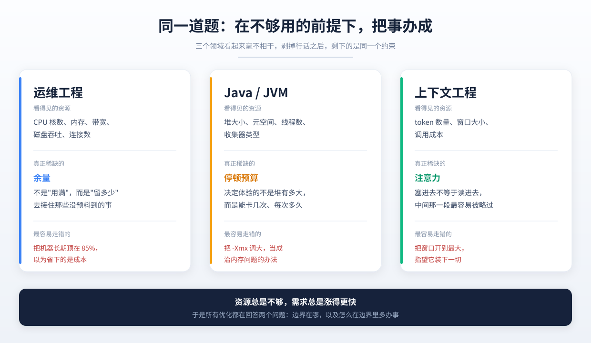

# 有限资源的管理与优化

## 从服务器到上下文窗口，一道题的三种写法

有个工程师先后管过三样东西：机房的服务器、跑在服务器上的 JVM、以及隔着一层接口跟他对接的大模型。干久了他发现一件事——调机器、调堆、调提示词，用的竟然是同一副脑子。

这个发现值得写下来。因为大多数"优化经验"是以行话的形式流传的：运维讲水位，JVM 讲晋升，提示词讲召回。换一个领域，这些词就全部失效，人也得从零开始。可只要把这些行话剥掉，剩下的是同一句话：**东西不够用，得在不够用的前提下把事办成。**

---

## 一、机房里的余量

先说运维。这是最实在的领域，因为机器不会配合你演戏——撑不住就是撑不住，直接崩给你看。

运维手里的资源都能数清楚：几核 CPU、多少内存、磁盘能扛多少并发读写、网卡跑多快。但真正要紧的从来不是总量，而是**还剩多少**。一台长期跑在 85% CPU 的机器，看上去很省钱，实际上是在同时下三个注：赌流量不会突然涨，赌这次发布没引入死循环，赌今晚没人请假。这三个注，通常会在同一个晚上一起输。

所以运维优化的核心动作不是"用满"，而是"留多少"。买几台机器是容量规划，撑不住时先关掉哪个功能是降级，什么时候主动断开连接是熔断，哪些活不必重干是缓存。说到底是同一笔交易：牺牲一小块，保住整条命。

SLO 和错误预算把这件事说得最透。它承认"可靠性"这种感受没法直接管理，于是换成一个额度：这个月允许你挂多少分钟。额度还有剩，就放心改；额度见底，就冻结发布。模糊的经验，变成了一条能查的数字。

## 二、堆里的垃圾

JVM 是个特别好的观察对象，因为它把"标称"和"实际"的差距摆得清清楚楚。

你给 JVM 划了 16G 的堆，但你并不真能用到 16G。收集器自己要占地方，每个对象自带一笔头部开销，内存反复分配释放还会留下缝隙。真正干活的空间，永远比标签上的数字小一圈。所有调优的功夫，都花在这道缝里。

JVM 最聪明的一个判断是：绝大多数对象活不过下一次分配。刚创建出来的临时变量，转手就该死了。既然如此，何必用同样贵的办法处理它们？于是年轻代用"扫地出门"的方式快速清场，只有老年代才值得仔细打扫。这不是什么高深算法，就是一个常识——**成本应该跟着寿命走**。

还有一条更容易被忽略的道理：少产生垃圾，比打扫得快更管用。一个每秒造 2G 垃圾的程序，你换再贵的收集器，也不过把每次卡顿从 50 毫秒压到 5 毫秒；但要是把临时对象的创建砍掉一半，卡顿可能直接消失。这就像屋里一直落灰，吸尘器买得再猛，也不如先把漏风的窗户堵上。

## 三、窗口里的注意力

最后说上下文。这是三者中看起来最阔气的一个——十几万 token 的窗口，好像怎么塞都塞不满。

实际上塞得满，而且塞满了就坏。模型对开头和结尾记得清楚，中间那一大段容易被略过；无关的背景资料不会安静待着，它会分散注意力；重复的示例越多，模型越不知道该听哪一句。窗口还剩一半，回答的质量已经掉下去了。

所以上下文真正的资源不是 token 数量，而是**能被认真读进去多少**。它的办法和前两个领域一一对上：不全塞、需要时再查，这就是缓存；长了就摘要、分层压缩，这就是分代回收；把固定不变的内容放最前面让缓存命中，这就是局部性；重要记忆挪到外部数据库，这就是冷热分层。

而最容易走的那条歪路，就是扩容。窗口从 3 万开到 20 万，问题好像解决了：成本涨了，速度慢了，注意力更散了。这和把 `-Xmx` 从 4G 调到 32G 治内存问题一模一样——你没消灭压力，只是把每天几次的小堵车，换成了半年一次的彻底瘫痪。

---

## 四、能搬家的经验

三条线捋到一块，能留下几条几乎不用改写就能跨领域套用的原则。

**先量，再改。** 没有数据支撑的调优都是碰运气。改 GC 参数凭感觉，改提示词也凭感觉，本质上是同一件事。

**先减需求，再扩供给。** 这条最反直觉，也最好用。少造垃圾胜过换收集器，少塞内容胜过开大窗口，少接无效请求胜过加机器。

**给峰值留位置。** 留余量看着像浪费，其实是在买保险。把系统顶在极限上跑，省下的是钱，押上的是稳定性，而账总在流量最高的那天结。

**分层，并让相近的东西挨在一起。** 热数据放近处，冷数据放远处；相关的内容摆在一起。操作系统的页缓存、JVM 的分代、模型的前缀缓存，讲的是同一件事。

**从固定阈值改成闭环反馈。** 负载高了自动扩容，堆占多了自动调整策略，上下文也该按任务类型动态拼装，而不是一份模板走天下。

具体到上下文工程，最值得从运维和 JVM 借来的，是两个习惯。

第一个是**把它当堆来观测**。记录每一轮注入了多少 token、哪些段落真被用上了、压缩丢掉了什么。先有这张表，才谈得上优化——就像先有 GC 日志，才谈得上调 JVM。

第二个是**给它一份预算和淘汰规则**。系统提示占多少、检索结果占多少、历史对话占多少，各划一条线。超了就按价值淘汰，而不是从尾巴上直接砍。砍尾巴最省事，代价是把最近、最要紧的指令一起砍掉；按价值淘汰才像 LRU，它承认每段内容的分量不一样。

最后剩下的其实是一种看问题的顺序：先问这个系统的"有效容量"到底有多大，再问卡在哪一层，最后才决定是省着用，还是加供给。这个顺序，比任何具体参数都值钱。
